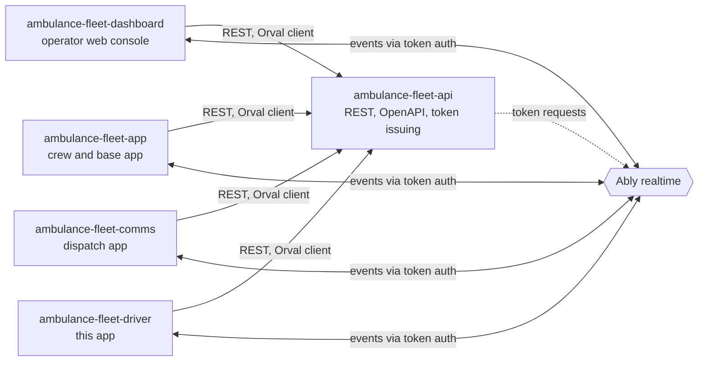
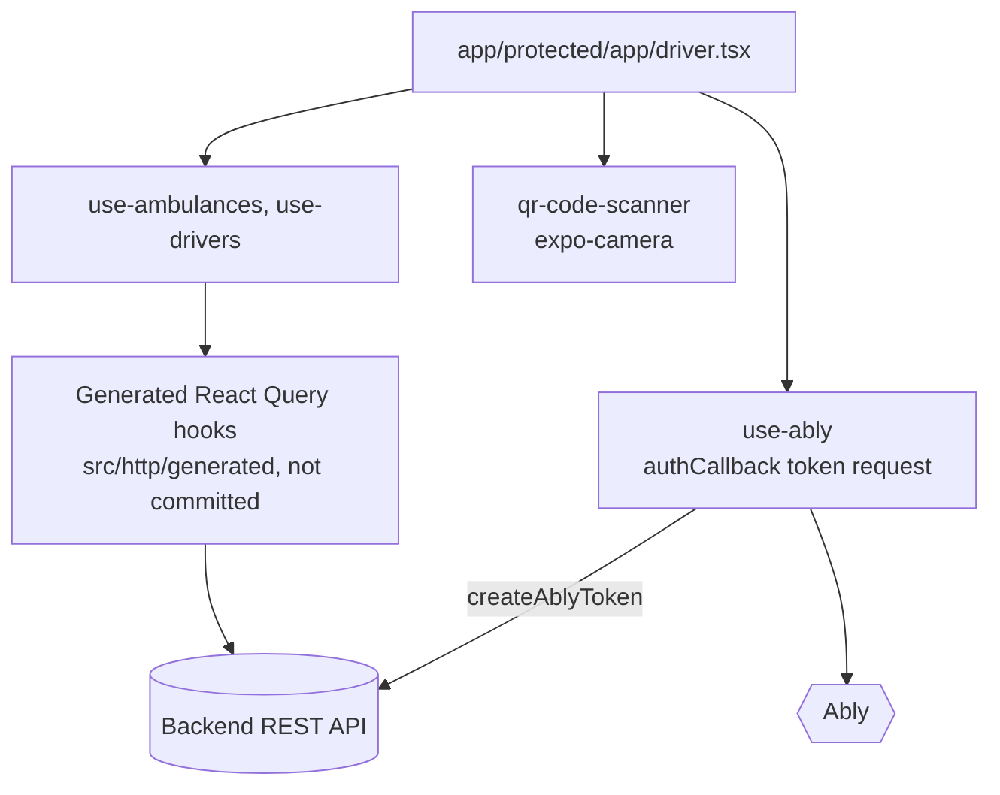
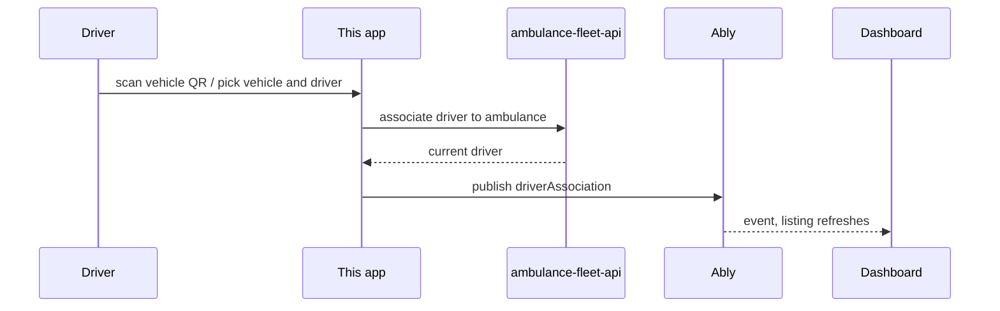

# ambulance-fleet-driver

Expo mobile app for ambulance drivers on a fleet platform: sign in, pick a company and vehicle, scan the vehicle QR code and register as the driver on duty.

**Status:** prototype client for a separate backend; not claimed to be in production use. No automated tests.

## What it does

- Sign-in as a driver with route guards (`app/public`, `app/protected`).
- Company and vehicle selection modals (`src/components/select-company-modal.tsx`, `src/components/vehicle-selection`).
- QR-code scanning with the device camera (`src/components/qr-code-scanner.tsx`).
- Associate or release the driver for the selected ambulance through the API, then announce it over Ably as a `driverAssociation` event (`src/hooks/use-drivers.ts`, `app/protected/app/driver.tsx`).
- Realtime connection over Ably using backend-issued tokens (`src/services/use-ably.ts`).
- API client generated from the backend OpenAPI contract with Orval.

## Architecture

System context:



Inside this app:



Driver association flow:



Boundaries:

- `app/`: file-based routes, `public/` (sign-in) and `protected/` (driver screen).
- Data hooks wrap generated queries so screens stay free of API details.
- `src/env/index.ts`: zod-validated environment, fails fast at boot.

## Key engineering decisions and trade-offs

- One Ably channel per company group (`connect-<companyGroupId>`), authenticated by backend-issued token requests, so no realtime key ships in the app (`src/services/use-ably.ts`).
- Contract-first client generated by Orval from the backend OpenAPI file (`orval.config.ts`). Trade-off: generated code is not committed.
- Deliberately small surface: one protected screen, two data hooks.

## Tech stack

Expo 54, React Native, Expo Router, NativeWind, TanStack Query, Ably, Expo Camera, zod, Orval.

## Getting started

Prerequisites: Node 20+, Yarn, Android Studio or Xcode, the API repository checked out next to this one.

```bash
yarn install
cp .env.example .env
npx orval          # generates src/http/generated; edit the input path in orval.config.ts first
npx expo prebuild
yarn android       # or: yarn ios
```

| Variable | Purpose |
| --- | --- |
| `EXPO_PUBLIC_BACKEND` | Backend API base URL |
| `EXPO_PUBLIC_APP_VERSION` | Version string used by `app.config.js` |

`orval.config.ts` points at an old sibling folder name (`../connect-server-refactor/swagger.json`); change it to your API checkout's `swagger.json`.

## Testing

No automated tests; lint with `yarn lint`.

## Project structure

```text
app/        expo-router screens (public, protected)
src/        components, hooks, services (Ably), env, lib
assets/     images and fonts
```

## Related repositories

- [ambulance-fleet-api](https://github.com/mkwitko/ambulance-fleet-api): REST API
- [ambulance-fleet-dashboard](https://github.com/mkwitko/ambulance-fleet-dashboard): operator web console
- [ambulance-fleet-app](https://github.com/mkwitko/ambulance-fleet-app): crew and base app
- [ambulance-fleet-comms](https://github.com/mkwitko/ambulance-fleet-comms): dispatch communications app

## License

All rights reserved. Source available for portfolio review.
