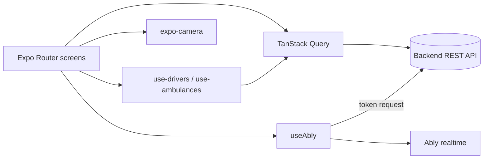

# connect-driver-app

Mobile app (Expo / React Native) for vehicle drivers: pick a company and vehicle, scan a QR code and receive live dispatch updates.

Status: prototype client for a separate backend; not in production use as far as this repository shows. No automated tests.

## What it does

- Sign-in against the backend with role-based route guards.
- Company selection and vehicle selection modals (`src/components/`).
- QR-code scanning with the device camera (`src/components/qr-code-scanner.tsx`).
- Live updates over Ably using backend-issued tokens (`src/services/use-ably.ts`).
- API client generated from the backend OpenAPI spec with Orval.

## Architecture



- `app/`: file-based routes, `public/` (sign-in) and `protected/` (driver screen).
- `src/http/generated/`: Orval output (not committed; run `npx orval` with the backend OpenAPI file path set in `orval.config.ts`); `src/env/index.ts`: Zod-validated environment.

## Key decisions

- One Ably channel per company group, authenticated by backend-issued token requests, so no realtime key ships in the app.
- Data hooks wrap generated queries so screens stay free of API details.

## Tech stack

Expo 54, React Native, Expo Router, NativeWind, TanStack Query, Ably, Expo Camera, Zod, Orval.

## Getting started

Prerequisites: Node 20+, Android Studio or Xcode.

```bash
yarn install
cp .env.example .env
npx expo prebuild
yarn android   # or: yarn ios
```

| Variable | Purpose |
| --- | --- |
| `EXPO_PUBLIC_BACKEND` | Backend API base URL |
| `EXPO_PUBLIC_APP_VERSION` | Version string used by `app.config.js` |

## Testing

No automated tests; lint with `yarn lint`.

## License

All rights reserved. Source available for portfolio review.
